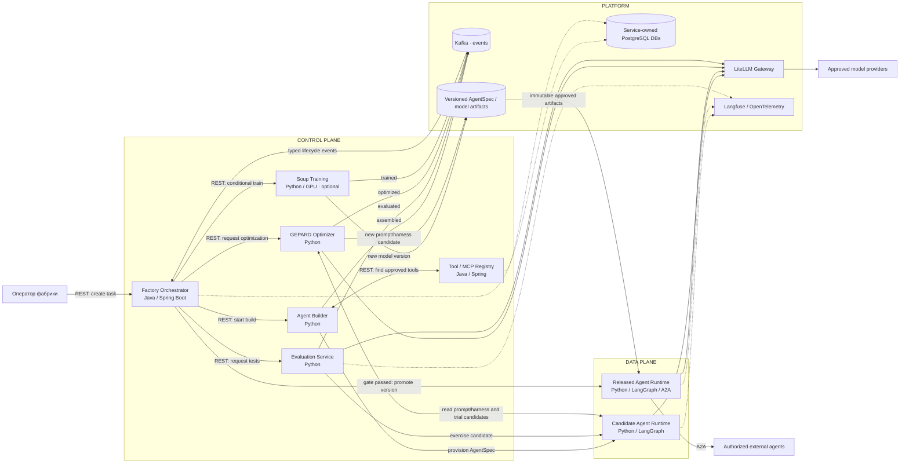
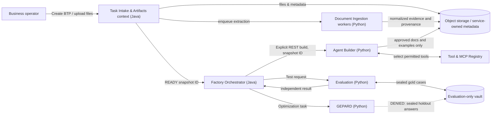

# C4 Level 2 — Revised Container Diagram (owner review)

**Status:** DRAFT, reflecting owner's three corrections. The project owner has not ratified the full ADR-0002. Architecture style: microservices.

## Source-of-truth interaction rules

1. **Orchestrator calls Builder directly:** explicit authenticated REST request with Build ID and idempotency key. Returns 202 + status reference if async; completion announced through Kafka.
2. **Kafka never makes decisions:** producers publish typed events, subscribed code handlers update Orchestrator's persisted state machine. Build start is not an implicit inference from a topic name.
3. **GEPARD accesses the agent directly:** authorized access to current AgentSpec/prompt/harness and sandbox candidate runs (or versioned artifact view). It creates a proposal, does **not** mutate the serving production agent before evaluation. The Orchestrator automatically rolls out accepted low-risk versions following independent holdout, security gates and rollback readiness; higher-risk changes wait for approval.
4. **Soup is called by Orchestrator directly:** owner/decision policy can request specialized training after diagnostics or proactively. Soup has no mandatory GEPARD prerequisite. Its model artifact is versioned and subject to exactly the same independent quality gates.
5. **Agent Runtime:** one reusable Python/LangGraph runtime image, initially a separate container per generated agent, with PostgreSQL checkpoints. Pi Durable remains a separate R&D comparison, not a runtime dependency in the MVP.
6. **Storage:** separate ownership per service, not a shared writable schema. The diagram combines databases into one icon to reduce clutter. AgentSpec and model artifacts are immutable and versioned. Secrets are injected only at runtime.
7. **LiteLLM:** centralized gateway for candidate/released runtimes, GEPARD and model-based evaluators; per-tenant limits and persistence enforced.
8. **A2A:** only a released agent is externally exposed; policy and customer authorization enforced at the ingress/runtime.

## Confirmation pending

Service count and deployability, REST/Kafka contract details, approved release thresholds, training triggers and deployment environment require owner sign-off in ADR-0002.

## Proposed extended C4: Business Task Package (owner review pending)

This diagram shows **candidate bounded responsibilities**, NOT an owner-approved new microservice count. Runtime inputs are distinct from historic build-time examples. Never route customer file bytes or secret keys through Kafka topics.
